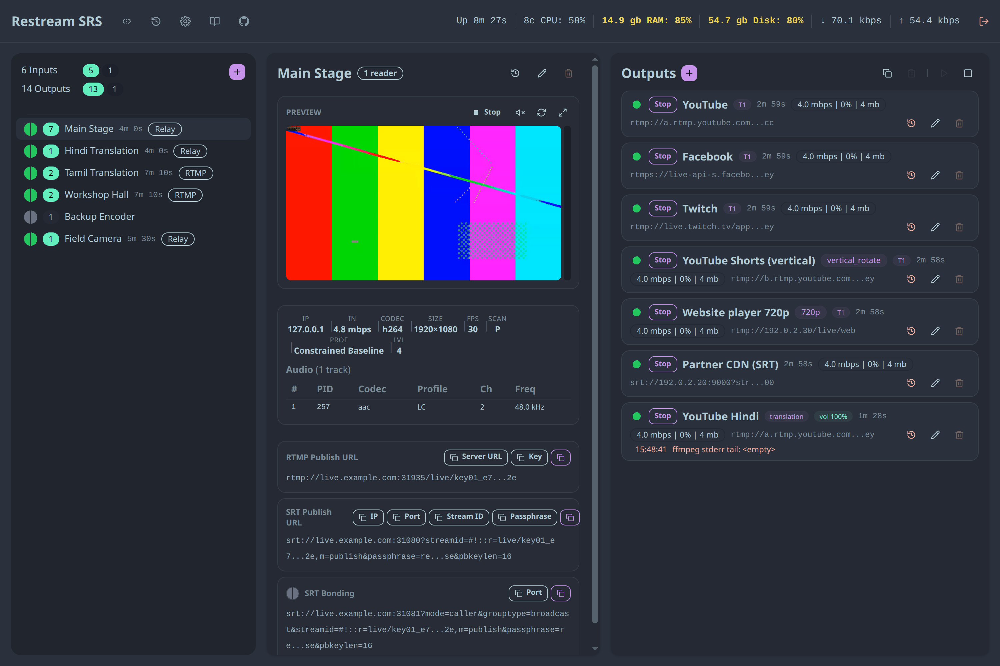
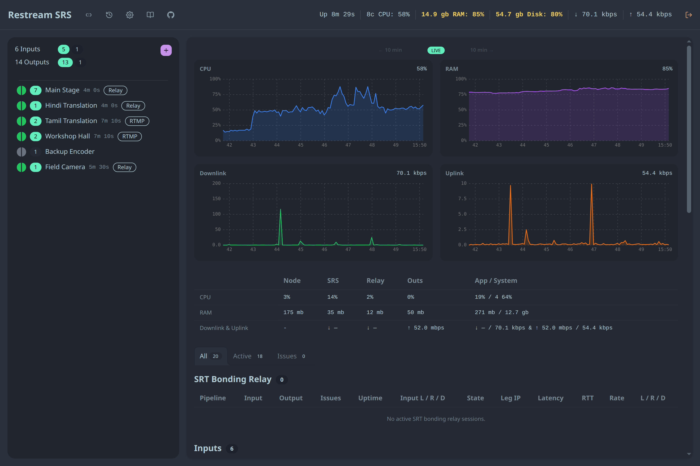
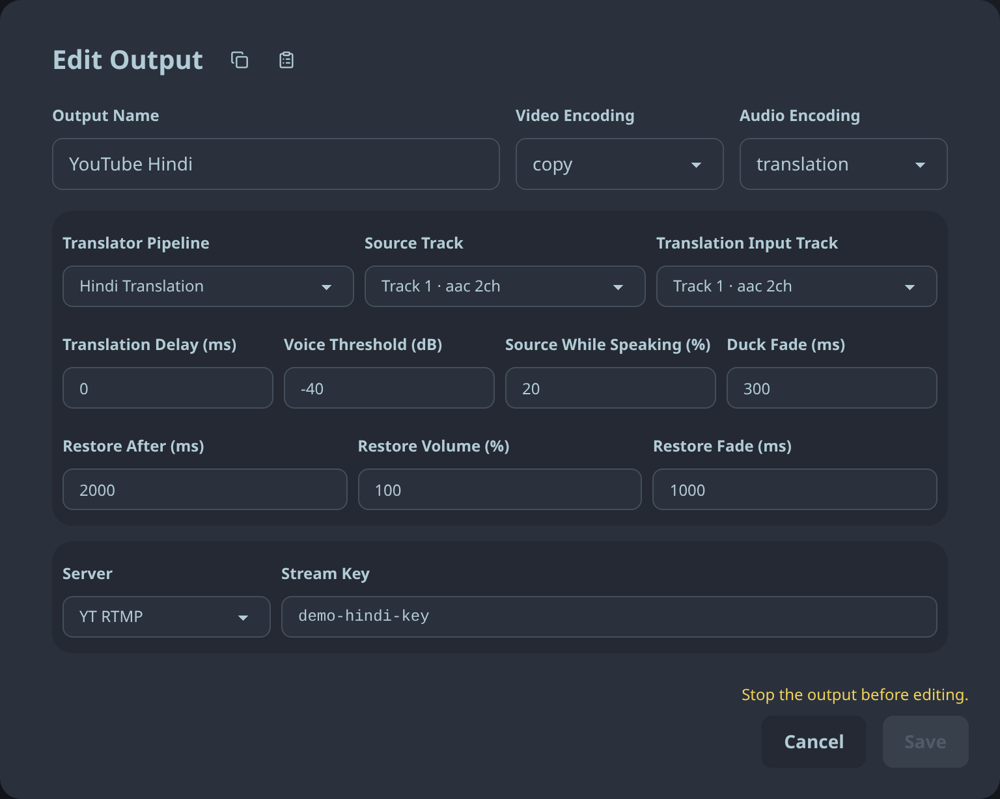

# Bunryu

_Bunryu (分流, "branching flow"): one live stream, many destinations._

[](https://github.com/live-miracles/bunryu/actions/workflows/ci.yml)
[](LICENSE)
[](https://live-miracles.github.io/projects/bunryu/)

**Self-hosted restreaming server for long live events.** Take inputs over RTMP, SRT and bonded SRT, and forward each one to many RTMP/RTMPS/SRT destinations (YouTube, Facebook, Twitch, CDNs) from one Linux server. Watchdogs restart a failed output without affecting the others.

Built on official [SRS](https://github.com/ossrs/srs) for ingest, [`goryu`](https://github.com/live-miracles/goryu) for bonded SRT ingress, and FFmpeg for outputs, with a Node.js + TypeScript control plane, web dashboard and REST API.

| [Install](docs/1-getting-started/3-install.md) | [Try with Docker](docs/1-getting-started/2-docker.md) | [Documentation](docs/README.md) |
| --- | --- | --- |



## Features

- [Ingest](docs/2-usage/1-publishing.md) over RTMP, SRT and bonded SRT, with stream-key authorization and passphrase-protected SRT.
- [Forward](docs/2-usage/2-outputs.md) each input to many RTMP, RTMPS or SRT destinations: up to 50 inputs and 500 outputs per server. Copy-mode (passthrough) outputs cost almost no CPU.
- [Transcode](docs/2-usage/2-outputs.md#video-encoding) a few outputs to 720p, 1080p or a rotated vertical feed for Shorts/Reels, and [select audio tracks](docs/2-usage/2-outputs.md#audio) per output, including multi-track SRT outputs.
- [Mix translation audio](docs/2-usage/3-translation.md) from an interpreter's pipeline over the source, with speech detection, ducking, delay and restore timing. If the translator drops, the output continues with source audio.
- [Recover automatically](docs/3-operations/4-reliability.md): stall, socket and memory watchdogs with bounded restarts. One failing destination never affects the others.
- Keep [post-incident evidence](docs/3-operations/4-reliability.md#input-timestamp-fault-detection): per-output Error History with FFmpeg stderr tails, grouped timestamp warnings, and [rotated structured diagnostics](docs/3-operations/3-configuration.md).
- Watch everything in a live dashboard: HLS preview, ffprobe media details, bitrates, host and per-process CPU/RAM/network charts, and copy-ready publish URLs.
- Restart safely: SRS accepts publishes only once the control plane is ready, and all configuration persists in SQLite.

| Overview | Translation output |
|---|---|
|  |  |

## Quick start

Try it with Docker:

```bash
git clone https://github.com/live-miracles/bunryu
cd bunryu
docker compose up -d
docker compose logs bunryu | grep "dashboard password"
```

Open `http://localhost:8080`, log in with the printed password, create a pipeline and publish to the URL the dashboard shows.

Install on a server (Debian/Ubuntu, x86_64, systemd), the recommended setup for production:

```bash
sudo git clone https://github.com/live-miracles/bunryu /opt/bunryu
sudo bash /opt/bunryu/scripts/server-install.sh
```

The installer prints the dashboard password. See [Native install](docs/1-getting-started/3-install.md) for firewall ports, updates and the SRT passphrase, and [Remote access](docs/3-operations/2-remote-access.md) for reaching the dashboard securely.

## Documentation

- **Getting started:** [Introduction](docs/1-getting-started/1-introduction.md) · [Docker](docs/1-getting-started/2-docker.md) · [Native install](docs/1-getting-started/3-install.md)
- **Usage:** [Publishing](docs/2-usage/1-publishing.md) · [Outputs](docs/2-usage/2-outputs.md) · [Translation outputs](docs/2-usage/3-translation.md)
- **Operations:** [Security](docs/3-operations/1-security.md) · [Remote access](docs/3-operations/2-remote-access.md) · [Configuration](docs/3-operations/3-configuration.md) · [Reliability](docs/3-operations/4-reliability.md) · [Known issues](docs/3-operations/5-known-issues.md)
- **Reference:** [REST API](docs/4-reference/1-api.md) · [Development](docs/4-reference/2-development.md)

## License

[MIT](LICENSE). SRS, goryu and FFmpeg are separate projects under their own licenses.
